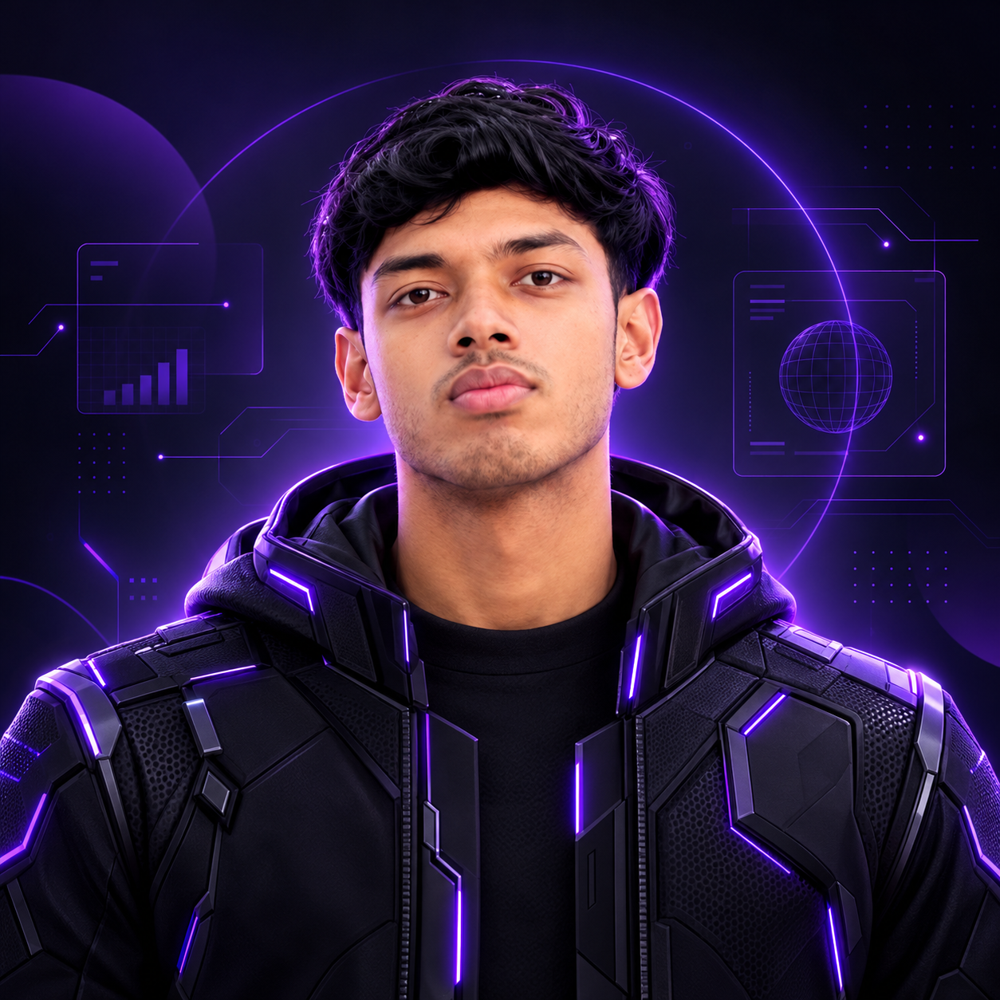

<div align="center">



# 👋 Hi, I'm Ali Ibtisam

### 🧠 Data Scientist | Machine Learning Engineer | AI Developer


<br>


</div>


---

# 🧬 SYSTEM PROFILE


```python
Ali_Ibtisam = {

"role": "Data Scientist | ML Engineer",

"education":
"Data Science @ Albukhary International University 🇲🇾",

"cgpa":
"3.84 / 4.0",

"focus":
[
"Machine Learning",
"Generative AI",
"Business Intelligence",
"Predictive Analytics"
],

"mission":
"Turning data into intelligent decisions 🚀"

}
```


---

# ⚡ WHAT I BUILD


<div align="center">


```
        DATA

          ↓

   MACHINE LEARNING

          ↓

     AI SYSTEMS

          ↓

 BUSINESS INTELLIGENCE

          ↓

 REAL WORLD IMPACT
```


</div>


---

# 🚀 FEATURED PROJECTS


## 🧠 DataPilot AI

### AI Business Intelligence Command Center


```
Natural Language

      ↓

LLM

      ↓

Secure SQL

      ↓

Database

      ↓

BI Dashboard
```


<div align="center">


| Metric | Result |
|-|-|
| Security Tests | 100/100 |
| SQL Attacks Blocked | 34/34 |
| Query Speed | <50ms |
| Stack | LangChain + Groq + SQL |


</div>


---

## 📊 Customer Churn Intelligence


```
Customer Data

      ↓

Feature Engineering

      ↓

XGBoost

      ↓

SHAP Explainability

      ↓

Prediction Dashboard
```


<div align="center">


| Metric | Score |
|-|-|
| Dataset | 7,043 Customers |
| ROC-AUC | 0.88 |
| Recall | 0.78 |
| Model | XGBoost |


</div>


---

## 🛒 AIU Market


### Student Marketplace Platform


```
Next.js

+

Supabase

+

PostgreSQL
```


```
👥 70+ Users

📦 25+ Listings

🚀 Live Platform
```


---

# 🪐 TECH ORBIT


<div align="center">


<br><br>


</div>


### 🧠 AI Stack

```
Scikit-Learn
XGBoost
Random Forest
SHAP
LangChain
Groq
Streamlit
```


### 📊 Analytics Stack

```
Power BI
Tableau
Plotly
Matplotlib
Seaborn
```


---

# 🌌 BEYOND CODE


<div align="center">


| Interest | Exploration |
|-|-|
| 🤖 AI Research | Building intelligent systems |
| 📸 Photography | Visual storytelling |
| 🌍 Travelling | Exploring new perspectives |
| 📚 Learning | Continuous improvement |
| 📊 Visualization | Turning data into stories |


</div>


---

# 🪪 AI DEVELOPER CARD


```
╭──────────────────────╮
│  ALI IBTISAM         │
├──────────────────────┤
│ Data Scientist       │
│ ML Engineer          │
│ AI Developer         │
│                      │
│ CGPA: 3.84           │
│ Scholarship: FULL    │
│ Location: Malaysia   │
╰──────────────────────╯
```


---

# 📈 GITHUB COMMAND CENTER


<div align="center">


</div>


---

# 🐍 CONTRIBUTION MATRIX


<div align="center">


</div>


---

# 🎓 EXPERIENCE


## 🚀 GeeksforGeeks Campus Ambassador


```
✓ Recruited 60+ students

✓ Increased engagement by 35%

✓ Conducted technical sessions
```


---

# 🏆 CERTIFICATIONS


```
🐍 Python Data Associate
   DataCamp


🤖 Armenia LLM Summer School
   Nebius AI
```


---

# 🌐 CONNECT


<div align="center">


<a href="https://aliibtisam.vercel.app">

</a>


<a href="mailto:aliibtisam1001@gmail.com">

</a>


<a href="https://linkedin.com/in/aliibtisam1001">

</a>


</div>


<br>


<div align="center">


### "Data is raw intelligence. AI is how we refine it."


💜 Built with Python + AI


</div>
