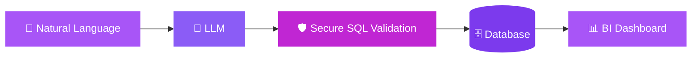
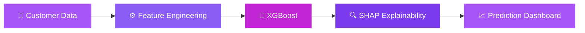

<!-- ═══════════════ HEADER ═══════════════ -->
<div align="center">


<p align="center"></p>

<a href="https://git.io/typing-svg">

</a>

<br/>


<br/><br/>

<a href="https://aliibtisam.vercel.app"></a>
<a href="https://linkedin.com/in/aliibtisam1001"></a>
<a href="mailto:aliibtisam1001@gmail.com"></a>

</div>


<!-- ═══════════════ ABOUT ═══════════════ -->
## 🧬 About Me

<table>
<tr>
<td width="55%" valign="top">

I'm a **Data Science student at Albukhary International University 🇲🇾**, studying on a scholarship.

I build systems where **machine learning**, **generative AI**, and **business intelligence** meet, with a focus on models that are accurate, explainable, and secure.

> 🎯 **Mission:** Turning data into intelligent decisions.

</td>
<td width="45%" valign="top">

```python
class AliIbtisam:
    role = "Data Scientist | ML Engineer"
    focus = [
        "Machine Learning",
        "Generative AI",
        "Business Intelligence",
        "Predictive Analytics",
    ]
    currently = "Building AI-powered BI tools"
```

</td>
</tr>
</table>

<div align="center">


</div>


<!-- ═══════════════ PROJECTS ═══════════════ -->
## 🚀 Featured Projects

> 💡 **Click a project to expand or collapse its details.**

<details open>
<summary><b>🧠 DataPilot AI: AI Business Intelligence Command Center</b></summary>
<br/>

Ask questions in plain English; get validated SQL, results, and a BI dashboard.



<div align="center">


<br/>


<br/><br/>

<a href="https://datapilot-ai-by-aliibtisam.streamlit.app/"></a>

</div>

</details>

<details open>
<summary><b>📊 Customer Churn Intelligence</b></summary>
<br/>

Churn prediction with SHAP explainability so retention teams can see *why* each customer is at risk.



<div align="center">


<br/><br/>

<a href="https://customer-churn-prediction-by-ali-ibtisam.streamlit.app/"></a>

</div>

</details>

<details open>
<summary><b>🛒 AIU Market: Student Marketplace Platform</b></summary>
<br/>

A live full-stack marketplace built for the university community.

<div align="center">


<br/>


<br/><br/>

<a href="https://aiumarket.com/"></a>

</div>

</details>


<!-- ═══════════════ TECH ═══════════════ -->
## 🪐 Tech Orbit

<div align="center">


</div>

<details>
<summary><b>🧠 AI &amp; Machine Learning</b></summary>
<br/>


</details>

<details>
<summary><b>📊 Analytics &amp; Visualization</b></summary>
<br/>


</details>


<!-- ═══════════════ STATS ═══════════════ -->
## 📈 GitHub Command Center

<div align="center">


</div>

## 🐍 Contribution Graph

<div align="center">

<sub>Each square is one day of contributions. The snake eats your commits: darker purple means more activity.</sub>

<br/><br/>


<br/>

<sub>Less</sub>


<sub>More</sub>

</div>


<!-- ═══════════════ EXPERIENCE ═══════════════ -->
## 🎓 Experience &amp; Certifications

<table>
<tr>
<td width="50%" valign="top">

### 🚀 GeeksforGeeks Campus Ambassador

- ✅ Recruited **60+ students**
- ✅ Increased engagement by **35%**
- ✅ Conducted technical sessions

</td>
<td width="50%" valign="top">

### 🏆 Certifications

- 🐍 **Python Data Associate**, DataCamp
- 🤖 **Armenia LLM Summer School**, Nebius AI

</td>
</tr>
</table>


<!-- ═══════════════ BEYOND CODE ═══════════════ -->
## 🌌 Beyond Code

<div align="center">


</div>

<!-- ═══════════════ CONNECT / FOOTER ═══════════════ -->
## 🌐 Let's Connect

<div align="center">

<a href="https://aliibtisam.vercel.app"></a>
<a href="mailto:aliibtisam1001@gmail.com"></a>
<a href="https://linkedin.com/in/aliibtisam1001"></a>

<br/><br/>


</div>
